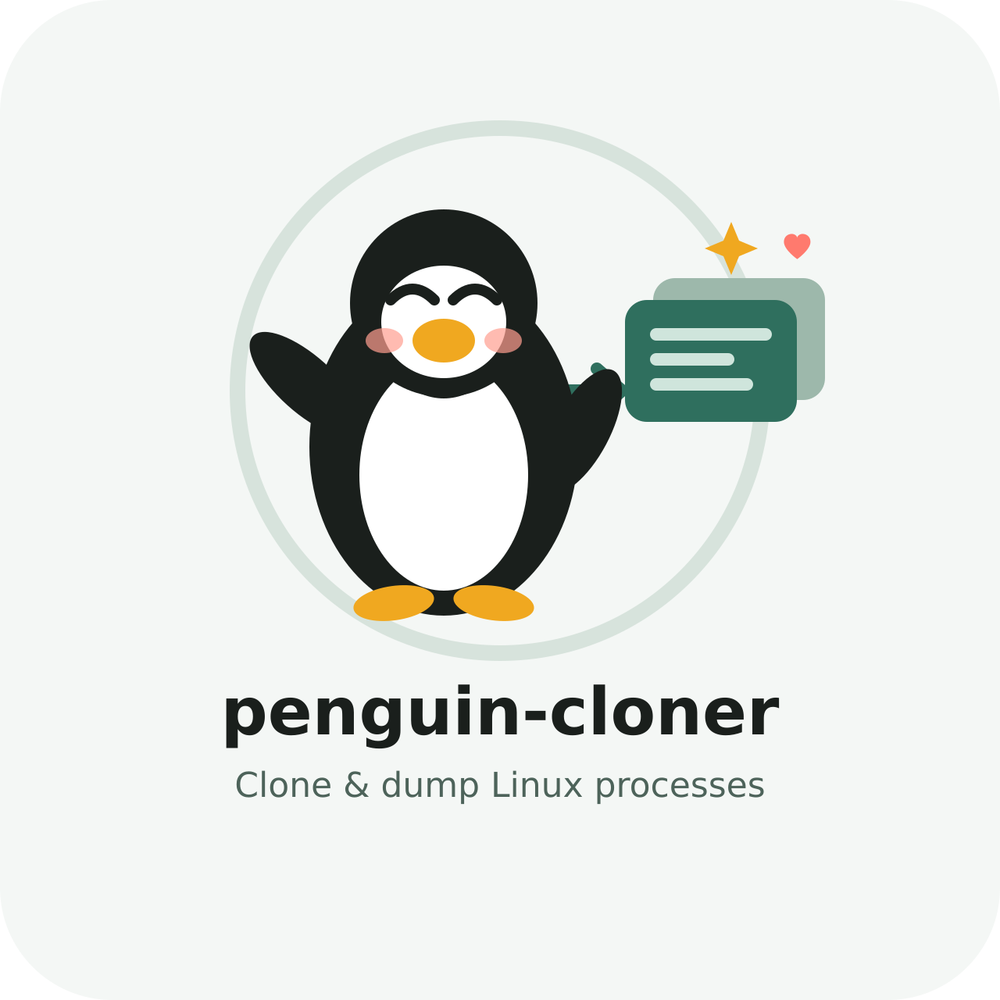

<p align="center">
  
</p>

# penguin-cloner

Dump a **running** Linux process: executable image, selected memory regions, and metadata — so you can recover configuration / state from a long-lived legacy daemon **before** rebooting the machine.

> **What this is:** forensic / disaster-recovery dump of binary + memory.  
> **What this is not:** a live resumable checkpoint. For true “pause process → reboot → continue”, use [CRIU](https://criu.org/).

## Why

On older servers a process may have been running for years with config that only exists in memory (or on a path nobody remembers). Before restart you want:

1. A copy of the **running binary** (`/proc/<pid>/exe`)
2. **Heap / stack / anonymous** memory (and optionally file-backed maps)
3. **cmdline**, **environ**, open **fds**, cwd
4. **Printable strings** from memory (paths, URLs, keys, config fragments)

### Motivational video

["Do not reboot" - story about a few ywars running server on production!](https://www.youtube.com/watch?v=qsSSpg0KGsg)

## Build

```bash
cargo build --release
# binary: target/release/penguin-cloner

# Verify this build can dump memory (spawns a child sleep)
./target/release/penguin-cloner self-test
```

Needs a Linux host (uses `/proc`, `ptrace`, `process_vm_readv`).

```bash
cargo test
cargo clippy --all-targets -- -D warnings
```

GitHub Actions CI (`.github/workflows/ci.yml`) runs `fmt`, `clippy`, `test`, release build, and `self-test` on every push/PR.

## Usage

```bash
# Inspect maps first
penguin-cloner maps --pid 12345

# Full recovery dump (freezes process briefly via ptrace).
# Prefer sudo: Yama ptrace_scope=1 blocks dumping unrelated same-uid processes.
sudo penguin-cloner dump --pid 12345 --out ./clone-12345

# Smaller dump: heap + stack only
sudo penguin-cloner dump --pid 12345 --heap-stack-only --out ./clone-hs

# Include mapped libraries / binary pages (large)
sudo penguin-cloner dump --pid 12345 --include-file-backed --out ./clone-full

# Do not freeze (racy but no attach)
sudo penguin-cloner dump --pid 12345 --no-freeze --out ./clone-live

# Re-scan strings from an existing dump
penguin-cloner strings --dir ./clone-12345 --interesting-only
```

### Output layout

```
clone-12345/
  manifest.json          # full report
  process.json           # pid metadata
  cmdline.txt
  environ.txt
  maps.txt               # raw /proc/pid/maps
  exe.bin                # running image from /proc/pid/exe
  exe_ondisk_copy.bin    # if path still exists on disk
  memory/                # one file per dumped region
  memory_index.json
  strings.txt            # printable strings
  strings.json
  memory_combined.bin    # optional (--combined)
  memory_combined.json
```

## Permissions

You need **one of**:

- root, or
- `CAP_SYS_PTRACE`, or
- be a parent of the target (Yama `ptrace_scope=1` allows dumping descendants only)

Also check Yama:

```bash
cat /proc/sys/kernel/yama/ptrace_scope
# 0 = classic; 1 = restricted (default on many distros)
```

## Limits (honest)

| Goal | This tool | Better tool |
|------|-----------|-------------|
| Save binary + memory for analysis | yes | — |
| Recover in-memory config / paths / secrets as strings | yes | — |
| Restart the **same** process image after reboot with open sockets, threads, exact CPU state | no | **CRIU** |
| Reconstruct deleted-on-disk binary still mapped | partial (`exe.bin`) | `/proc/pid/exe` + this dump |

A raw memory dump cannot be “executed again” like a saved VM. Use the dump to **rebuild config and re-launch** the service, or use CRIU if you truly need checkpoint/restore.

## How it works

1. Read `/proc/<pid>/{cmdline,environ,cwd,exe,fd,maps,status}`
2. Optionally `ptrace(ATTACH)` to freeze the process for a consistent snapshot (falls back if attach is denied)
3. Read regions via `process_vm_readv`, falling back to `/proc/<pid>/mem`
4. Write region files + string extraction
5. `ptrace(DETACH)` + `SIGCONT`

## License

MIT
